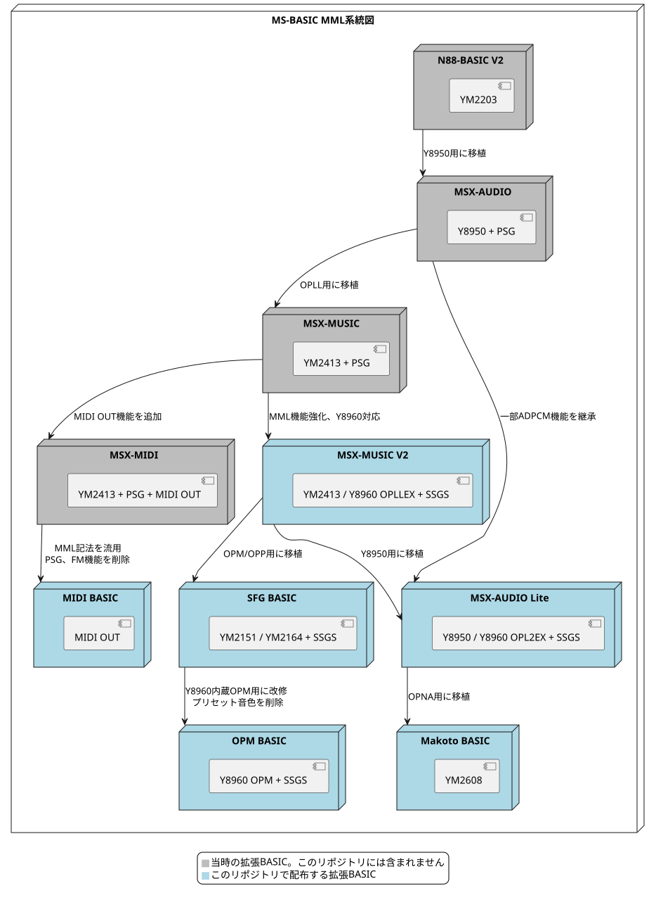

# Documentation

[日本語](README.md) | English

The specifications of the BASIC extensions in MSX Sound Suite Extension. Each one is a translation of a Japanese original, which it links to and which is authoritative where the two differ.

## MSX-MUSIC BASIC Extension V2

- [MSX-MUSIC BASIC Extension V2 Reference](msx-music/en/basic-reference.md)
- [MSX-MUSIC BASIC Extension V2 New Features (differences from the original)](msx-music/en/new-feature.md)

## MSX-AUDIO BASIC Extension Lite

- [MSX-AUDIO BASIC Extension Lite Reference](msx-audio/en/basic-reference.md)
- [Differences from MSX-MUSIC BASIC Extension V2](msx-audio/en/diff-from-mmbe.md)
- [Differences from the original MSX-AUDIO BASIC extension](msx-audio/en/diff-from-msxaudio.md)

## SFG BASIC Extension / OPM BASIC Extension

- [SFG BASIC Extension / OPM BASIC Extension Reference](sfg/en/basic-reference.md)
- [Differences from MSX-MUSIC BASIC Extension V2](sfg/en/diff-from-mmbe.md)

## MIDI Play BASIC Extension

- [MIDI Play BASIC Extension Reference](midi/en/basic-reference.md)
- [Differences from the original MSX-MIDI BASIC extension](midi/en/diff-from-msxmidi.md)

## Makoto BASIC Extension

- [Makoto BASIC Extension Reference](makoto/en/basic-reference.md)
- [Differences from MSX-AUDIO BASIC Extension Lite](makoto/en/diff-from-lite.md)

## Y8960 BASIC Extension / Y8960 Sequencer BIOS

- [Y8960 BASIC Extension Reference](y8960/en/basic-reference.md)
- [MSX Sound Suite integration interface (for ROM and application developers)](y8960/en/msse-abi.md)
- [Y8960 hardware (the parts this firmware depends on)](y8960/en/hardware.md)
- [Y8960 Sequencer BIOS (for application developers)](y8960/en/sequencer-bios.md)
- [Y8SQ format (the bytes of a sequence; for authors of cross compilers and players)](y8960/en/bytecode.md)
- [Y8960 PCM file format (EXPORT PCM / IMPORT PCM; for tool authors)](y8960/en/pcmfile.md)

## Development

- [Building and releasing (maintenance of this repository, in Japanese)](build-and-release.md)
